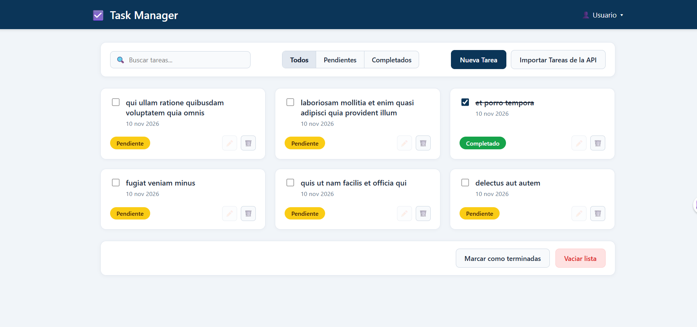
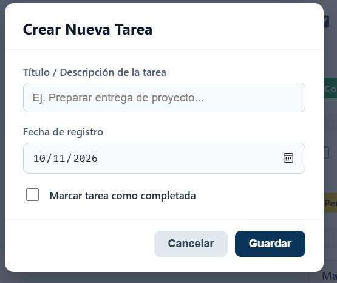
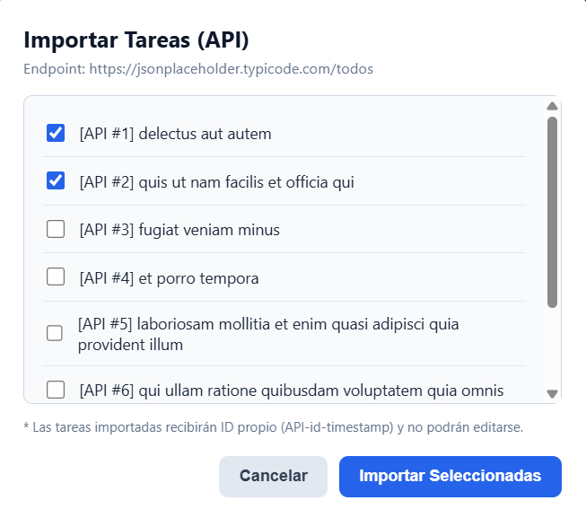

# 📋 Task Manager - Gestor de Tareas

Este proyecto es una página web para organizar tareas que hicimos en equipo. La idea principal es que cualquier persona pueda entrar, anotar sus tareas pendientes con fecha, marcarlas cuando ya las termine y también traer tareas de prueba desde internet (usando la API de JSONPlaceholder). Todo lo que se hace en la página queda guardado en el navegador para que no se borre al recargar.

## 👥 Equipo de Trabajo y qué hizo cada uno

Nos dividimos el trabajo en dos ramas de Git para trabajar al mismo tiempo sin pisarnos el código y luego unimos todo en la rama `main`:

**Dainer Pereira (`feature/Dainer`)**
* Armó la base del `index.html` y los estilos principales (`style.css` y `responsive.css` para que se vea bien en celular y computador).
* Programó toda la parte de `LocalStorage` (`almacenamiento.js`) para guardar, crear, editar y borrar las tareas en el navegador.
* Creó el componente de la tarjeta (`tarjeta-tarea.js`) y la ventana emergente para crear o editar tareas (`modal-formulario.js`) usando Web Components y Shadow DOM.
* Configuró los botones de abajo para "Marcar como terminadas" y "Vaciar lista".

**Sebastián (`feature/sebastian`)**
* Diseñó el acomodo de las tarjetas en columnas y los estilos de los formularios y filtros (`layout.css` y `forms.css`).
* Hizo la conexión con la API de internet (`conexion-api.js`) usando `fetch`, `async/await` y `try/catch` como vimos en clase.
* Creó la ventana emergente para escoger qué tareas importar desde la API (`modal-importar.js`) con sus casillas de selección.
* Programó el buscador en tiempo real y los botones de arriba para filtrar entre *Todos*, *Pendientes* y *Completados*.

**Trabajo en conjunto (`main`)**
* Entre los dos conectamos todo en el archivo `app.js` y resolvimos los conflictos al unir las ramas mediante Pull Requests.

## ⚙️ Cómo funciona la aplicación

1. **Crear tareas propias:** Al darle al botón azul **"Nueva Tarea"**, sale una ventana donde escribes el título, eliges la fecha y decides si ya está lista o sigue pendiente. Al guardar, aparece enseguida su tarjeta en la pantalla.
2. **Importar tareas desde la API:** Al darle a **"Importar Tareas de la API"**, la página se conecta a `https://jsonplaceholder.typicode.com/todos` y muestra una lista de tareas. Uno marca con un chulito cuáles quiere traer y le da a **"Importar Seleccionadas"**.
3. **Regla especial para las tareas de la API:** Cuando traemos una tarea de internet, el código le pone un ID único (`API-id-timestamp`) para que no se confunda con las tareas creadas por nosotros. Además, **las tareas de la API tienen bloqueado el botón del lápiz (editar)** porque son datos externos de solo lectura; solo se pueden marcar como completadas o eliminar.
4. **Filtros y buscador:** Arriba hay una barra para buscar tareas por nombre a medida que uno escribe, y tres botones para ver todas las tareas juntas, solo las pendientes (amarillas) o solo las completadas (verdes).
5. **Guardado automático:** Todo se guarda en `LocalStorage`. Si cierras la pestaña o recargas con F5, las tareas siguen ahí.

## 🎨 Comparación: Wireframes vs. Resultado Final

Aquí comparamos el diseño que planeamos al inicio (Wireframes) contra cómo nos quedó ya programado en el navegador:

### Vista 1: Pantalla Principal y Tarjetas

**1. Diseño planeado (Wireframe):**

**2. Cómo nos quedó implementado:**

### Vista 2: Ventanas Modales (Crear Tarea e Importar de API)

**1. Diseño planeado (Wireframe):**

**2. Cómo nos quedó implementado:**
**Crear nueva tarea**

**Importar Tareas (API)**

**Importar Tareas (API)**
## 🧪 Resumen de Pruebas Realizadas

Revisamos cada botón y función de la página para asegurarnos de que no salieran errores en la consola.

* **Crear y editar tareas locales:** Probamos creando tareas nuevas y cambiándoles el nombre con el botón del lápiz. Funcionó bien.
* **Traer datos de la API:** Probamos seleccionando varias tareas del modal y comprobamos que se agregan a la lista con su ID propio.
* **Bloqueo de edición en tareas de API:** Verificamos que a las tareas traídas de la API les salga el botón del lápiz desactivado para que nadie las pueda editar.
* **Buscador y filtros:** Probamos escribiendo palabras en el buscador y cambiando entre *Todos*, *Pendientes* y *Completados*.
* **Recargar la página:** Recargamos con F5 y verificamos que no se pierda ninguna tarea guardada.

## 📁 Carpetas del Proyecto

* `css/` → Archivos de estilos separados por partes (`style.css`, `layout.css`, `forms.css`, `responsive.css`).
* `js/componentes/` → Los 3 Web Components con Shadow DOM (`tarjeta-tarea.js`, `modal-formulario.js`, `modal-importar.js`).
* `js/datos/` → El manejo de `LocalStorage` (`almacenamiento.js`) y el consumo de la API (`conexion-api.js`).
* `js/app.js` → Archivo principal que une los componentes con la pantalla.
* `wireframes/` → Imágenes guía del diseño inicial.
* `capturas/` → Fotos de cómo quedó nuestra página terminada.
* `pruebas/` → Documento y evidencias de las pruebas que hicimos.

## 🚀 Cómo abrir el proyecto

1. Descarga o clona este repositorio en tu computador.
2. Ábrelo en **Visual Studio Code**.
3. Dale clic derecho al archivo `index.html` y selecciona **Open with Live Server** (es necesario abrirlo con Live Server porque usamos módulos `import` y `export` de JavaScript).