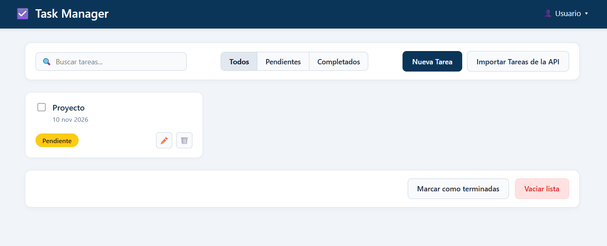
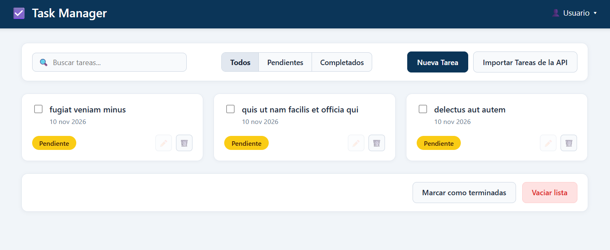
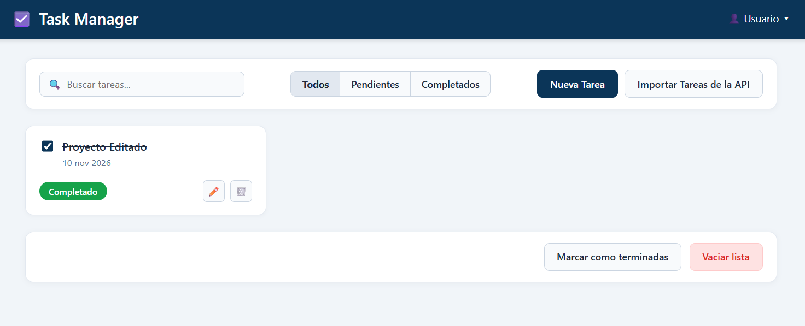
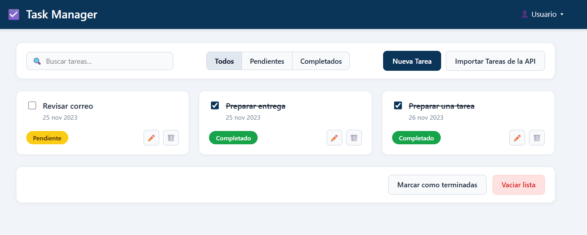

# 🧪 Pruebas de la Aplicación (Task Manager)

Aquí documentamos las pruebas que hicimos entre Dainer y Sebastián para comprobar que todos los puntos de la rúbrica funcionen bien en el navegador.

## 1. Prueba de creación de tarea nueva
* *Qué hicimos:* Le dimos clic al botón *"Nueva Tarea", escribimos un título, pusimos la fecha y le dimos a *"Guardar"**.
* *Qué pasó:* Se cerró la ventana y apareció la tarjeta nueva de primera en la lista con la etiqueta amarilla de "Pendiente".
* *Resultado:* ✅ Funcionó bien.

<!-- Si tienen captura de esta prueba, guárdenla en la carpeta pruebas como prueba-1.png -->
.

## 2. Prueba de importar tareas desde la API
* *Qué hicimos:* Le dimos al botón *"Importar Tareas de la API", esperamos a que cargara la lista de JSONPlaceholder, marcamos 3 tareas y le dimos a *"Importar Seleccionadas"**.
* *Qué pasó:* Las 3 tareas aparecieron en la página, se guardaron con el ID API-id-timestamp y el botón del lápiz les quedó bloqueado como pedía la guía.
* *Resultado:* ✅ Funcionó bien.

<!-- Si tienen captura de esta prueba, guárdenla en la carpeta pruebas como prueba-2.png -->
.

## 3. Prueba de cambiar estado (Pendiente / Completado) y Editar
* *Qué hicimos:* Marcamos el chulito (checkbox) de una tarea pendiente y luego editamos el título de una tarea creada por nosotros.
* *Qué pasó:* Al marcar el chulito, la etiqueta pasó de amarillo ("Pendiente") a verde ("Completado") y el texto se tachó. Al editar nuestra tarea local, el cambio se guardó enseguida.
* *Resultado:* ✅ Funcionó bien.

<!-- Si tienen captura de esta prueba, guárdenla en la carpeta pruebas como prueba-3.png -->
.

## 4. Prueba de filtros, buscador y botones de abajo
* *Qué hicimos:* Escribimos en la barra de búsqueda, probamos los botones Todos / Pendientes / Completados, y al final probamos los botones *"Marcar como terminadas"* y *"Vaciar lista"*.
* *Qué pasó:* El buscador filtró las tarjetas al instante, los botones mostraron solo las tareas que correspondían y al recargar la página con F5 todo siguió guardado en LocalStorage.
* *Resultado:* ✅ Funcionó bien.

<!-- Si tienen captura de esta prueba, guárdenla en la carpeta pruebas como prueba-4.png -->

